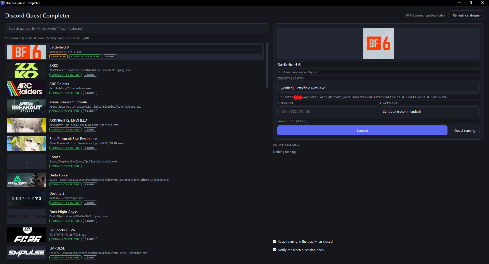

# Discord Quest Completer

Completes the "play a game" type of Discord quest without installing the game.



Discord decides which game you are playing by looking at the executable of each
running process. It keeps a public list of every game it can recognise, and for
most of them it checks the end of the path as well, so `Marvel Rivals` means a
process at `...\MarvelRivals\MarvelRivals_Launcher.exe`. This program builds
that folder structure, puts a small placeholder program at the end of it, and
runs it for as long as you choose. Discord sees the game running and the quest
progresses.

Nothing is downloaded from the game publisher, and none of your real games are
touched.

## Requirements

Windows 10 or later. Steam is not required.

## Getting it

Download `DiscordQuestCompleter.exe` from the
[latest release](../../releases/latest). It is a single file and needs no
installation.

Windows will most likely warn you the first time you run it, with a blue
"Windows protected your PC" box. Choose **More info**, then **Run anyway**.
This happens because the file is not signed with a paid code-signing
certificate, so SmartScreen has no reputation history for it. It is not a
judgement about what the program does, and the warning fades as a release
accumulates downloads. If you would rather not take that on trust, all the
source is here: run it with `python run.py`, or build the executable yourself
with `python build.py` and compare.

To run from source instead:

```
pip install -r requirements.txt
python run.py
```

## Using it

1. Search for the game the quest asks for. The list opens on the games with
   community-confirmed paths; typing searches all 10,000 or so that Discord
   knows about.
2. Set how long to run it for. Leave the field empty for 15 minutes. It
   understands `20m`, `1h30m`, `25:00`, plain seconds like `900`, and
   arithmetic like `10 * 60`.
3. Press Launch. A small window appears with a countdown. Leave it open, and
   check the quest in Discord after a minute to confirm the progress is moving.

The countdown window carries the game's own icon and name, so it reads as the
game rather than as a generic window. This is cosmetic only. Discord identifies
a game by its executable path and never looks at the icon.

Closing the countdown window only minimises it to the taskbar. The session
keeps running, because that window is the process Discord is watching. To end a
session early, press **Stop**, either in the countdown window or next to the
session in the main window.

Everything the program created is removed when the session ends, whether it
finishes, you stop it, or the program is killed partway through.

### Running in the background

Closing the main window sends it to the system tray rather than quitting, so
sessions carry on and nothing is lost. The tray icon shows the time remaining,
and its menu reopens the window or quits properly. Quitting does stop running
sessions, and asks first.

When a session ends you get a notification saying whether it ran the full
duration or was stopped early. Both behaviours have checkboxes under the
session list and can be turned off. If your desktop has no system tray, the
window closes normally and the option is disabled.

### If the quest does not progress

Some games accept more than one executable. The **Executable path** dropdown
lists every path known for that game, with community-confirmed ones marked
`[verified]`. Try the next one down.

A few games appear to check that their folders were created by Steam. For
those, switch **Placement** to `Inside Steam library`. This writes into your
real `steamapps\common` folder instead of the app's own directory, and it will
refuse to run if you already own the game in question. If the game still is not
detected, download it on Steam and pause the download at one or two percent,
then try again with `Inside Steam library` selected.

## Where the paths come from

Two sources, combined:

**Discord's detectable application list.** A public endpoint, no account or key
needed, listing every application Discord can recognise along with the
executables it looks for. This is the same data Discord's own client uses, so
it is authoritative rather than a guess. A copy ships inside the program and is
refreshed in the background once a day.

**The r/DiscordQuests path index.** Folder structures that people have
confirmed working. Where a game appears in both, this one wins. It also covers
a handful of games, Comet and Opera GX among them, that Discord lists with no
executables at all, so the community path is the only information there is.

Earlier versions of this program guessed at install paths using the Steam API,
which is why they often pointed at a launcher instead of the game and failed to
be detected. That guesswork is gone.

## What it writes to disk

By default, only inside:

```
%LOCALAPPDATA%\DiscordQuestCompleter\
```

That directory holds the fake game folders while a session runs, the cached
game list, and cached thumbnails. Administrator rights are not needed and no
real game is renamed or moved. Choosing `Inside Steam library` is the one
exception, and it asks for confirmation first.

If the program is killed while a session is running, the leftovers are recorded
on disk beforehand and cleaned up the next time it starts.

## Marking quests as live

The program cannot read your active quests, because that would require your
Discord account token. A token grants full control of the account, and a tool
that reads one has no way to prove it is not stealing it, so it is not
something this program will ever ask for.

Instead, press **Mark quest running** on a game. It is badged `QUEST LIVE` and
sorted to the top of the list until you unmark it. The marks are yours alone
and are kept in `my_quests.json` in the application data folder.

There is also a shared list, `dqc/data/active_quests.json`, for anyone
maintaining a fork or a group of users. Point its `remote` field at a hosted
copy and the app will pull updates without a new release. It ships empty, since
a quest list that has gone stale is worse than none at all.

## Building

```
python tools/build_snapshot.py   # refresh the bundled game list
python tools/make_icon.py        # regenerate the icon, only after changing it
python build.py                  # produce dist/DiscordQuestCompleter.exe
```

Both data files are committed, so a plain `python build.py` is enough unless
you are changing them. The build stops with an explanation if either is
missing, or if a previous copy of the program is still running and holding its
own executable open.

Two executables are produced. `stub.exe` is the placeholder that gets copied
into the fake game folder, built separately so it stays around 11 MB rather
than carrying the whole interface with it. `DiscordQuestCompleter.exe` bundles
it along with the game data.

To check a build:

```
dist\DiscordQuestCompleter.exe --self-test
```

This runs a full session without opening the interface and writes the result to
`%LOCALAPPDATA%\DiscordQuestCompleter\selftest.txt`.

## Layout

```
dqc/
  catalog.py    game list, search, community overrides
  emulator.py   builds the folder structure, runs and cleans up the placeholder
  journal.py    records changes before they happen so a crash can be undone
  quests.py     the active-quest list
  settings.py   user preferences
  steamlibs.py  finds Steam libraries, used to avoid games you own
  duration.py   reads the duration field
  thumbs.py     artwork from Steam and Discord, cached to disk
  stub.py       the placeholder program
  window.py     the interface
tools/          data builder and check scripts
```

The check scripts under `tools/` verify the game list, the emulation and
cleanup cycle, the interface, and that closing the countdown window leaves the
session running. Run them after changing anything.

## Contributing paths

If you find a working path that is not listed, add it to
`dqc/data/overrides.json` and open a pull request. Include the game name
exactly as Discord spells it, which is not always how the wiki spells it, and
note anything unusual about how you confirmed it.

## Credits and licence

This began as a rewrite of
[typedecker/DiscordQuestCompleter](https://github.com/typedecker/DiscordQuestCompleter),
which used Kivy for its interface and guessed install paths from the Steam API.
None of that code is used here. The interface, path resolution, emulation and
cleanup, and packaging are all new, and paths now come from Discord's own
detectable-application list rather than from guesswork.

Released under the GNU General Public License v3, the same licence as the
project it grew out of. See `LICENSE` for the full text.

    Discord Quest Completer
    Copyright (C) 2026 Sinnisterly

    This program is free software: you can redistribute it and/or modify it
    under the terms of the GNU General Public License as published by the Free
    Software Foundation, either version 3 of the License, or (at your option)
    any later version. It is distributed in the hope that it will be useful,
    but WITHOUT ANY WARRANTY; without even the implied warranty of
    MERCHANTABILITY or FITNESS FOR A PARTICULAR PURPOSE.

The path index is maintained by the r/DiscordQuests community. Game artwork is
served by Steam and Discord and belongs to the respective publishers.

PySide6 is used under the LGPL v3, which is compatible with this licence.

## Disclaimer

This tool is provided for educational and research purposes.

It is not affiliated with or endorsed by Discord, any game developer, or their
parent companies. Simulating game activity may breach Discord's Terms of
Service, and using it may result in warnings, suspension, or a permanent ban.
The software comes with no warranty of any kind, and the authors accept no
liability for any account loss or other consequence of using it. You are
responsible for your own use of it.

If you do not agree, do not download or run it.
